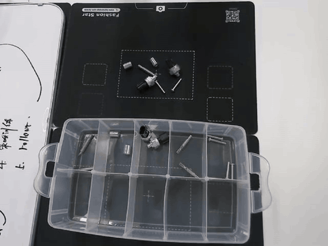
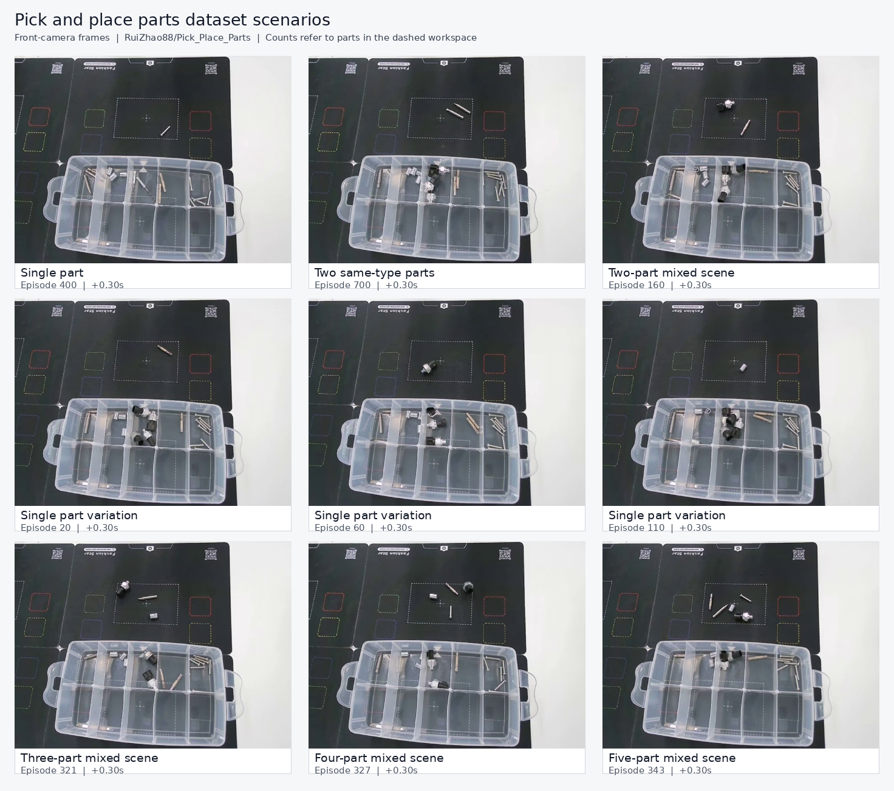

# EmbodiedAI-VLA-RobotArms-AssortingParticles

This project uses a customized [Evo-RL framework](https://github.com/Inmetherigersniffstherose/Evo-RL) to train a robot to sort parts into their corresponding containers. We trained the policy in two rounds, expanding from two part types and 500 demonstration episodes to five part types and 841 combined episodes. The final model achieved a reported success rate of **over 90%** when tested with random numbers and combinations of parts placed at random positions.

The dataset is available on Hugging Face: **[RuiZhao88/Pick_Place_Parts](https://huggingface.co/datasets/RuiZhao88/Pick_Place_Parts)**.

## A Successful Inference Episode

Playback at **5× speed**. Click the preview or [watch the MP4](assets/videos/successful_inference_5x.mp4).

## Task and workspace

The robot picks parts from a workspace marked by a white dashed-line box and places each part into the appropriate container. There are five part types, each associated with a destination container. Collection began with two types and expanded to the other three after testing the first trained policy.

Demonstrations varied part positions and orientations within the marked workspace. For example, one part could be placed in the top-right corner with its tail tilted, while another lay flat in the bottom-right corner. This variation was intended to expose the policy to different arrangements of the same parts.

## Dataset scenarios

Representative front-camera frames show single parts, same-type pairs, and mixed scenes containing two to five parts in the dashed workspace. Captions identify the source episode and timestamp.

## Round one collection and training

The first round used **500 episodes** involving two part types and their two destination containers:

- **Single-part scenes — 200 episodes:** 100 episodes for each type, with one part placed at different positions within the white dashed-line box.
- **Two parts of the same type — 200 episodes:** 100 episodes for each type, varying the positions and orientations of both parts to cover a broad range of arrangements.
- **Two parts of different types — 100 episodes:** one part of each of the two types in the workspace.

We trained the first policy on these 500 episodes using the Evo-RL VLM + VLA process, then tested the model before collecting the second round of data.

## Round two collection and training

The second round expanded the task to all **five part types and destination containers**. The approximate collection breakdown was:

- **The three additional part types:** approximately 50 episodes per type, with scenes containing one or two parts of that type.
- **Mixed-part scenes:** approximately 200 episodes distributed across random combinations of two, three, four, or five different part types, with one part of each selected type in a scene.

The category counts are approximate. The exact number of additional episodes was **341**, bringing the combined dataset to **841 episodes**.

For the second training round, we used the model from round one as the base model and ran the VLM + VLA process again on the full combined dataset. The second round therefore trained on the original 500 episodes together with the 341 additional episodes, rather than training only on the new data.

## Evaluation and results

We evaluated the final model in **three runs of 20 uninterrupted inference cases**. Test scenes contained random numbers of randomly selected parts from the five types, placed at random positions. Under these conditions, the model achieved a reported task success rate of **over 90%**.

The observed failure case was an occasional sorting error: the robot picked up a part but placed it into the wrong destination bin. Correct destination selection remains an area for improvement.

The reported evaluation result is separate from the success labels attached to demonstration episodes. Those labels describe the collected data and are not the model's autonomous evaluation success rate.

## Dataset details

The published dataset uses **LeRobot v3.0** format and contains:

- **841 episodes** and **596,020 frames**, recorded at **30 FPS**.
- Approximately **5.52 hours** of recorded episode data, excluding resets.
- Front and wrist RGB camera streams at **640 × 480** resolution.
- Seven-dimensional robot observations and actions: shoulder pan, shoulder lift, elbow flex, wrist flex, wrist yaw, wrist roll, and gripper.
- Robot type: `rebot_b601_follower`.
- Task instruction: `sort, pick and place parts`.

The uploaded snapshot was verified against all 76 local files using file sizes and SHA-256 hashes. Its Hugging Face revision is [`ce72636a31d9035acc25cbac4ceaf65bedbd7aa6`](https://huggingface.co/datasets/RuiZhao88/Pick_Place_Parts/tree/ce72636a31d9035acc25cbac4ceaf65bedbd7aa6).

## Customized robot setup

The project uses a **single reBot B601-DM follower arm** with a **reBot Arm 102 leader** for teleoperation. The wrist camera is mapped to `/dev/cam_left` and the front camera to `/dev/cam_back`; both capture at 640 × 480 and 30 FPS. The follower uses a Damiao serial CAN bridge, while the leader uses FashionStar UART servos.

See [the hardware setup guide](docs/hardware-setup.md) for device ports, calibration, control settings, runtime dependencies, and collection and evaluation commands. The repository includes [the hardware configuration](configs/hardware.json), [an editable environment template](configs/robot.env.example), and a [snapshot of the customized drivers](hardware/driver_snapshot/).

## Repository organization

This is a standalone public project repository under [Inmetherigersniffstherose](https://github.com/Inmetherigersniffstherose), maintained alongside the customized Evo-RL framework. Clone the two repositories into sibling directories. Reusable framework and robot integration changes belong in Evo-RL; task documentation, dataset references, configurations, experiment records, and the archived project drivers belong here.

- `configs/dataset.json`: dataset reference and verified statistics.
- `docs/experiments.md`: training and evaluation record templates.
- `docs/repository-setup.md`: repository organization and cloning instructions.

The framework is based on [MINT-SJTU/Evo-RL](https://github.com/MINT-SJTU/Evo-RL). Large datasets, videos, and model checkpoints are stored outside Git.
